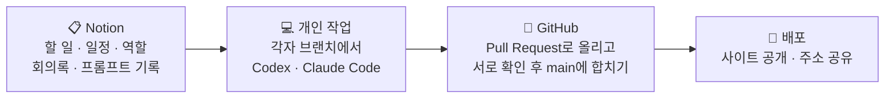

<div align="center">


<br>

<sub>TEAM PROJECT · 2026</sub>

# 🎬 STUDIO 상상 통합 홈페이지

**상상을 넘어 장면이 되다**<br>
기획부터 AI 영상 제작까지 맡아 주는 가상의 AI 영상 제작사, **STUDIO 상상**의 홈페이지입니다.<br>
팀원 4명이 AI 코딩 도구(Codex · Claude Code)와 함께 한 사람이 한 페이지씩 맡아 만들었어요.

<br>

[](https://kimsoyeon-saovia.github.io/saovia88/)


| 팀명 | 기간 | 발표일 |
| :-: | :-: | :-: |
| **인생2막** | 2026.10.13 ~ 10.22 | 2026.10.23 |

</div>

<br>

## 📑 목차

1. [👥 팀원과 역할](#-팀원과-역할)
2. [🗺️ 사이트 구조](#️-사이트-구조)
3. [📄 페이지별 소개](#-페이지별-소개)
4. [🤖 AI 도구 활용](#-ai-도구-활용)
5. [🔍 벤치마킹](#-벤치마킹)
6. [🤝 협업 방식](#-협업-방식)
7. [📱 반응형](#-반응형)
8. [🧩 통합하며 해결한 문제](#-통합하며-해결한-문제)
9. [🪞 회고](#-회고)
10. [🚀 실행 방법과 폴더 구조](#-실행-방법과-폴더-구조)

<br>

## 👥 팀원과 역할

| | 이름 | 담당 페이지 | 페이지 역할 | 공통 업무 |
| :-: | :-- | :-- | :-- | :-- |
| 01 | **염혜리** (팀장) | 🏠 ABOUT US | 메인 화면 · 협력사 · 회사 소개 | Notion 정리 · 인스타그램 개설 |
| 02 | **이애리** | 🤖 AI VIDEO | AI 영상 제작 과정과 차별점 소개 | PPT 발표 |
| 03 | **유호원** | 🎞️ PORTFOLIO | AI 제작 영상 포트폴리오 구성 | 통합 및 배포 |
| 04 | **김소연** | ✉️ CONTACT | 개인 · 기업 견적 안내 페이지 | GitHub 관리 |

> **1인 1페이지** — 메뉴 4개를 한 사람씩 맡아 각자 페이지를 완성하고, GitHub에서 하나로 합쳤습니다.

<br>

## 🗺️ 사이트 구조

```text
STUDIO 상상 메인
│
├─ 🏠 ABOUT US ──── 회사 소개 · 서비스 · 협력사 안내 · 위치
│                   (메인 페이지와 바로 이어짐)
├─ 🤖 AI VIDEO ──── 제작 방식 · 제작 과정
├─ 🎞️ PORTFOLIO ─── 작업 영상 16편 · 프로젝트 개요 · 주요 활용 사례
│                   카테고리 필터: 전체 / 개인 / 기업 / 지역
└─ ✉️ CONTACT ───── 개인 견적 문의 · 기업 견적 문의 · 이벤트 안내

외부 링크  상담(카톡 · 전화 · 이메일) · 인스타그램 · 카카오채널
```

<br>

## 📄 페이지별 소개

### 🏠 ABOUT US — 회사를 소개하는 첫 화면 &nbsp;<sub>`main/` · 담당 염혜리</sub>

- 메인 배너 **"상상을 넘어 장면이 되다"** — 타자 효과 제목 + 좌우에서 날아오는 부제
- 파트너 기업 로고 띠 두 줄이 반대 방향으로 흐름 (65초 무한 반복, **움직임 멈추기** 버튼)
- 서비스 4종: 제작 · AI 하이브리드 · 사운드 · 드론
- "당신이 상상한 모든것을 현실로" 네 단어가 0.14초 간격으로 튀어 오름
- 포트폴리오 미리보기, 회사 위치 지도 연결

### 🤖 AI VIDEO — 제작 방식을 보여 주는 화면 &nbsp;<sub>`ai-video/` · 담당 이애리</sub>

- 배경 영상과 **"당신의 상상이 영상이 되다"** — 제목이 아래에서 위로 진해짐 (문장당 1.2초)
- 하는 일 3단계 **PLAN · CREATE · FINISH**
- 제작 과정 4단계: 상담 → 기획 → AI 제작 → 편집
- 상담 준비 안내창 + **양식 복사** 버튼
- WHAT WE DO 제목 위로 빛이 지나가는 효과, 패럴랙스 스크롤

### 🎞️ PORTFOLIO — 작업물을 모아 보여 주는 화면 &nbsp;<sub>`portfolio/` · 담당 유호원</sub>

- 메인 배너 영상이 끝나면 소개 문구 등장
- 카테고리 필터 4개(전체 · 개인 · 기업 · 지역)로 작업물 분류
- 카드에 마우스를 올리면 어두워지며 작품 제목 표시
- 카드를 누르면 프로젝트 상세창(개요 · 주요 활용 사례), 작업 영상 16편 재생

### ✉️ CONTACT — 견적을 내고 상담을 신청하는 화면 &nbsp;<sub>`contact/` · 담당 김소연</sub>

- 개인 / 기업 문의를 버튼 하나로 전환
- 화질 · 길이를 골라 담고 수량 1~999개 조절 → **예상 견적 자동 계산**
- 입력 확인 · 개인정보 동의 · FAQ, 상황별 안내창
- 상품 영상 미리보기, 스크롤을 따라오는 견적서

<details>
<summary><b>⚙️ 페이지별 사용 기술 보기</b></summary>

<br>

| 페이지 | 기능 | 사용 기술 |
| :-- | :-- | :-- |
| ABOUT US | 제작 문의 안내창 | `<dialog>` · `showModal()` |
| | 튀어 오르는 문장 | `IntersectionObserver` · `@keyframes` |
| | 흐르는 파트너 로고 | `@keyframes` 65초 무한 반복 |
| AI VIDEO | 상담 준비 안내창 · 양식 복사 | `<dialog>` · Clipboard API |
| | 진해지는 메인 제목 | `@keyframes` · `animationend` |
| | 빛나는 제목 · 패럴랙스 | `IntersectionObserver` · `transform` |
| PORTFOLIO | 분류 필터 | `data-filter` · `classList` |
| | 프로젝트 상세창 | `<dialog>` · `:hover` |
| | 영상 재생창 | `<video>` · `play()` · `pause()` |
| CONTACT | 상황별 안내창 | 직접 만든 `modal()` 함수 |
| | 아래에서 올라오는 등장 | `IntersectionObserver` |
| | 영상 미리보기 · 따라오는 견적서 | `<video>` · `requestAnimationFrame` |

</details>

<br>

## 🤖 AI 도구 활용

### Codex와 Claude Code, 이렇게 나눠 썼습니다

| 구분 | Codex | Claude Code |
| :-- | :-- | :-- |
| **맡은 작업** | 메인 · 서브 페이지 전체 | 휴대폰 반응형, 통합 후 오류 점검, GitHub 정리 · 발표 자료 |
| **활용 사례** | 페이지 제작, 통합 후 오류 수정, 버튼 · 메뉴 연결 | Notion 자료 정리, GitHub 관리, 통합 후 최종 점검 |
| **좋았던 점** | 원하는 화면을 이미지로 먼저 만들어 코딩 전에 확인 | 짧은 시간에 코딩, 여러 요청을 순서대로 처리, 작업 과정을 실시간 확인 |
| **아쉬웠던 점** | 통합 후 수정 시 요청과 다른 결과, 예전 버전으로 되돌아감 | 이미지 생성 기능이 없어 코딩 전 화면 미리보기 불가 |

### 💡 말보다 그림과 숫자로 요청하기

AI에게 "살짝 크게", "눈에 띄게"처럼 말하면 결과가 매번 달라졌어요.
그래서 **시안 · 캡처 · 손그림**으로 보여 주고, **px · pt · 초 · 색상 코드**로 요청했습니다.

| 도구 | 이렇게 썼어요 |
| :-- | :-- |
| 🎨 일러스트 | Illustrator로 화면 시안을 그려 GPT에 보여 주고 같은 배치로 요청 |
| 📏 알캡처 | 영역을 드래그해 px 크기를 재고, 그 숫자를 프롬프트에 그대로 적기 |
| ✏️ 펜 태블릿 | 캡처 위에 고칠 곳과 움직임 방향을 손으로 그려 이미지로 전달 |
| 🖍️ 그림판 | 간단한 수정은 빨간 박스와 화살표로 고칠 곳만 표시 |

**수정 요청 공식**

> **어디를**(그림판 표시 · 시안) **+ 얼마나**(px · pt) **+ 무슨 색**(`#E0FF4F`) **+ 어떻게**(초 · 순서) **+ 그대로 둘 것**(나머지는 유지)

```diff
- "견적 박스 좀 오른쪽으로 옮기고, 버튼 눈에 띄게 해 줘"
+ "견적 박스를 지도 오른쪽에 58px 띄워 배치해 줘. 제목 32pt Bold,
+  버튼 #E0FF4F 394 × 80. 첨부한 캡처의 분홍색 박스만 고치고 나머지는 그대로 둬"
```

<details>
<summary><b>🔧 AI가 자주 어긋난 곳과 해결 방법</b></summary>

<br>

| 어긋난 것 | 이런 일이 있었음 | 이렇게 해결 |
| :-- | :-- | :-- |
| 간격 · 크기 | 여백과 글자 크기가 요청할 때마다 달라짐 | px · pt 값으로 고정해서 요청 |
| 글꼴 | 지정하지 않은 기본 글꼴로 바뀜 | 글꼴 이름과 두께까지 적기 |
| 기존 디자인 | 한 곳을 고치면 다른 곳도 같이 바뀜 | '요청한 부분만 수정' + 작업 메모 파일 |
| 움직임 | 효과가 너무 빠르거나 한꺼번에 나옴 | 초 단위와 순서 번호로 요청 |
| 색 | 비슷하지만 다른 색이 들어감 | `#색상 코드`로 지정 |

**규칙** — 요청 끝에 항상 **"나머지는 그대로 둬"** 를 붙였습니다.

</details>

<details>
<summary><b>📝 다른 컴퓨터에서 이어서 작업하기 (작업 메모 파일)</b></summary>

<br>

집과 학원처럼 다른 컴퓨터에서 이어서 작업할 때, 작업 메모 파일을 만들어 Codex와 Claude Code가 먼저 읽게 했어요.

1. 확정된 디자인 · 동작 · 모션을 문서로 정리
2. 디자인을 마음대로 바꾸지 말라는 규칙 작성
3. 새 대화에서도 이어서 작업하도록 안내

> "이 폴더의 '1016_학원작업.md'를 읽고 기존 홈페이지 작업을 계속해. 현재 깃허브 연결이 승인된 상태야. 파일을 확인하고 내가 다시 올리는 내용 부분을 수정해줘"

</details>

<br>

## 🔍 벤치마킹

같은 업종(AI 영상 프로덕션) 홈페이지를 각자 찾아 공유하고, 항목별로 비교해 **구성과 기능 아이디어만** 참고했어요. 디자인은 베끼지 않았습니다.

| 살펴본 것 | 다른 회사 홈페이지는 | 우리는 이렇게 적용 |
| :-- | :-- | :-- |
| 첫 화면 | 대표 영상 · 큰 문구로 첫인상 | 타자 효과 큰 문구 + 배경 영상 |
| 메뉴 구성 | 회사 소개 · 작업물 · 문의로 단순하게 | ABOUT · AI VIDEO · PORTFOLIO · CONTACT |
| 포트폴리오 | 업종 · 용도별 분류, 썸네일 + 영상 | 개인 · 기업 · 지역 필터 + 영상 16편 |
| 제작 과정 | 상담 → 기획 → 제작 → 납품 소개 | 4단계 카드 + 상담 준비 안내창 |
| 가격 안내 | '문의 주세요'로 가격을 숨긴 곳이 많음 | 화질 · 길이 · 수량으로 **예상 견적 자동 계산** |

### ✨ 조사해 보니 없던 것, 우리가 더했습니다

- **CONTACT · 자동 견적** — 화질 · 길이 · 수량을 고르면 예상 견적이 바로 계산
- **AI VIDEO · 상담 준비 안내** — 상담 전에 준비할 4가지를 안내창으로 정리, 양식 복사
- **PORTFOLIO · 영상 소개** — 마우스를 올리면 프로젝트명, 누르면 개요와 주요 활용 사례

<br>

## 🤝 협업 방식



### GitHub 작업 규칙

| 규칙 | 내용 |
| :-- | :-- |
| **브랜치** | 한 사람당 하나 — `page/about` · `page/ai-video` · `page/portfolio` · `page/contact` |
| **커밋 메시지** | 무엇을 했는지 한 줄로 — `feat: 포트폴리오 필터 추가` · `fix: 모바일 메뉴 겹침 수정` |
| **Pull Request** | PR 올리기 → 팀원 1명 이상 확인 → `main`에 합치기 |
| **작업 기록** | `날짜_이름` 폴더로 누가 언제 올렸는지 바로 확인 |

<div align="center">

| 📁 업로드 파일 | 🗂️ 정리 폴더 | 📅 날짜·이름 폴더 | 👥 참여 팀원 |
| :-: | :-: | :-: | :-: |
| **518** | **10** | **36** | **4** |

</div>

### Notion으로 정리한 것들

- **할 일 보드** — 페이지별 진행 상황을 할 일 · 진행 중 · 완료로 관리
- **회의록** — 회의 날짜 · 결정한 것 · 다음 할 일 기록
- **프롬프트 기록** — 잘 된 프롬프트와 실패한 프롬프트를 모아 공유
- **역할 · 일정표** — 담당자와 마감일을 한눈에 정리

<br>

## 📱 반응형

PC 디자인은 그대로 두고, 휴대폰 규칙만 `@media` 안에 덧붙여 공통 파일 `site-header.css` 맨 아래에 모았어요.

| 화면 | 기준 | 적용 내용 |
| :-- | :-: | :-- |
| 🖥️ PC | 751px 이상 | 처음 만든 PC 디자인 그대로 (배치 · 글꼴 · 애니메이션 변경 없음) |
| 📱 휴대폰 | 750px 이하 | 글자 · 버튼 크기, 배치, 스크롤 조정 |
| 📱 작은 휴대폰 | 520px 이하 | 로고 아래로 메뉴를 내려 헤더를 두 줄로 (높이 104px) |

<details>
<summary><b>📱 페이지별로 휴대폰에서 달라지는 점</b></summary>

<br>

| 페이지 | 휴대폰에서는 |
| :-- | :-- |
| ABOUT US | 메뉴는 로고 아래 한 줄, 협력사 로고 45% 축소, 다음 화면에 맞춰 멈추는 장면 이동 |
| AI VIDEO | PLAN · CREATE · FINISH 카드를 세로로 쌓고, 제작 과정 제목 69px → 28px |
| PORTFOLIO | 첫 탭은 제목 표시, 두 번째 탭은 아래에서 올라오는 상세 시트 |
| CONTACT | 견적서는 하단 고정 바 + 담기 버튼, 바를 누르면 전체 견적서 시트 |

**점검** — 크롬 F12 기기 모드(375 · 390px)와 실제 휴대폰에서 네 페이지 모두 확인 완료
(메뉴 노출 · 글자 잘림 · 이미지 맞춤 · 버튼 크기 44~48px · 가로 스크롤 · 견적 계산)

</details>

<br>

## 🧩 통합하며 해결한 문제

| 문제 | 원인 | 해결 |
| :-- | :-- | :-- |
| 메뉴 · 헤더가 제각각 | 페이지마다 따로 만든 헤더 · 푸터 | `site-header.js` 하나로 모든 페이지에 적용 |
| 공통 스타일 분산 | 리셋 · 헤더 값이 페이지마다 따로 있음 | `reset.css` · `site-header.css` 한 곳에서 관리 |
| 글자가 깨져 보임 | 서울체 TTF가 작은 크기에서 획이 무너짐 | 서울알림체 OTF로 통일 |
| GitHub 업로드 거절 | 포트폴리오 HTML 113MB (이미지 32장 내장) | 이미지를 WebP 파일로 분리 |
| 영상 용량 초과 | 영상 한 개 180MB, 포트폴리오 영상 약 1GB | H.264 MP4로 압축 + `faststart` 적용 |
| 휴대폰에 마우스오버가 없음 | 터치 화면에는 hover 동작이 없음 | 첫 탭에 제목, 두 번째 탭에 상세창 |
| 휴대폰에서 예전 화면이 보임 | 브라우저 캐시 | 파일 주소에 버전 번호(`?v=`) 추가 |
| 선택을 바꾸면 등장 효과 반복 | 화면 전체를 다시 그림 | 바뀐 견적 부분만 다시 그리도록 수정 |
| 영상 경로 일부 오류 | 경로 연결 실수 | 확인 스크립트로 16편을 하나씩 검증 |

> 문제가 생기면 **원인을 먼저 찾고**, 고친 내용은 작업 메모에 남겼습니다.

<br>

## 🪞 회고

### AI와 함께 만들며 배운 것

| | |
| :-- | :-- |
| **01 · 보여 주면 빠르다** | 말보다 시안 · 캡처 · 손그림 한 장이 수정 횟수를 줄였습니다 |
| **02 · 숫자로 말하면 정확하다** | px · pt · 초 · 색상 코드로 요청하면 한 번에 원하는 크기와 속도가 나왔습니다 |
| **03 · 참고하되 우리 것으로** | 벤치마킹으로 기본을 잡고, 비어 있던 기능을 우리 아이디어로 채웠습니다 |

### 평가

| 👍 잘한 점 | 🤔 아쉬운 점 | 🔜 다음에는 |
| :-- | :-- | :-- |
| 1인 1페이지로 빠르게 분업<br>날짜·이름 폴더로 작업 기록 | 영상 용량으로 업로드 지연 | 모바일까지 처음부터 함께 설계 |

<br>

## 🚀 실행 방법과 폴더 구조

별도의 빌드나 설치 없이 루트의 `index.html`을 Chrome 또는 Edge로 열면 됩니다.
로컬 서버로 보려면 아래 명령을 실행하고 <http://localhost:8000> 으로 접속하세요.

```bash
python -m http.server 8000
```

```text
📦 STUDIO 상상
├─ 📄 index.html              # main/index.html로 이동하는 시작 페이지
├─ 🎨 reset.css               # 공통 CSS 초기화
├─ 🎨 site-header.css         # 공통 헤더 · 푸터 · 반응형 스타일
├─ ⚡ site-header.js          # 공통 헤더, 푸터, 페이지 이동
├─ ⚡ scene-scroll.js         # 화면 단위 스크롤과 터치 이동
├─ ⚡ site-enhancements.js    # TOP 버튼 및 페이지별 보조 기능
├─ 📂 main/                   # ABOUT US
├─ 📂 ai-video/               # AI VIDEO
├─ 📂 portfolio/              # PORTFOLIO
├─ 📂 contact/                # CONTACT (견적 설정: inquiry-config.js)
└─ 📂 social/                 # SNS 이미지
```

> [!IMPORTANT]
> 모든 파일이 상대 경로로 연결되어 있어요. 옮기거나 배포할 때는 **폴더 구조를 그대로 유지**해 주세요.

> [!NOTE]
> 이 저장소는 배포용 압축본입니다. 영상은 H.264 MP4로 압축하고, 큰 이미지는 WebP로 바꿔 GitHub 100MB 제한 안에 맞췄어요. 원본은 따로 백업해 두었습니다.

<br>

---

<div align="center">


<sub>팀 **인생2막** · 염혜리 · 이애리 · 유호원 · 김소연</sub><br>
<sub>© 2026 STUDIO 상상 (가상의 회사입니다)</sub>

</div>
